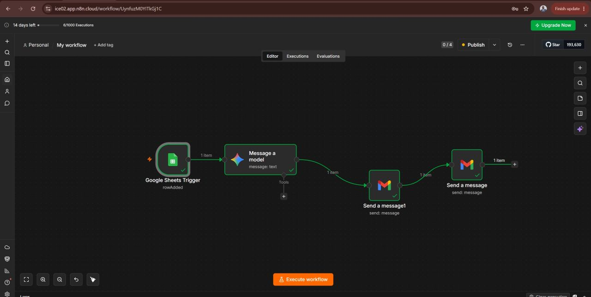
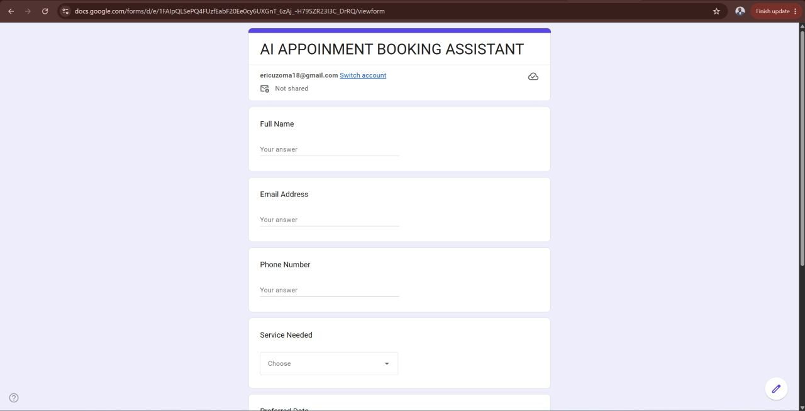
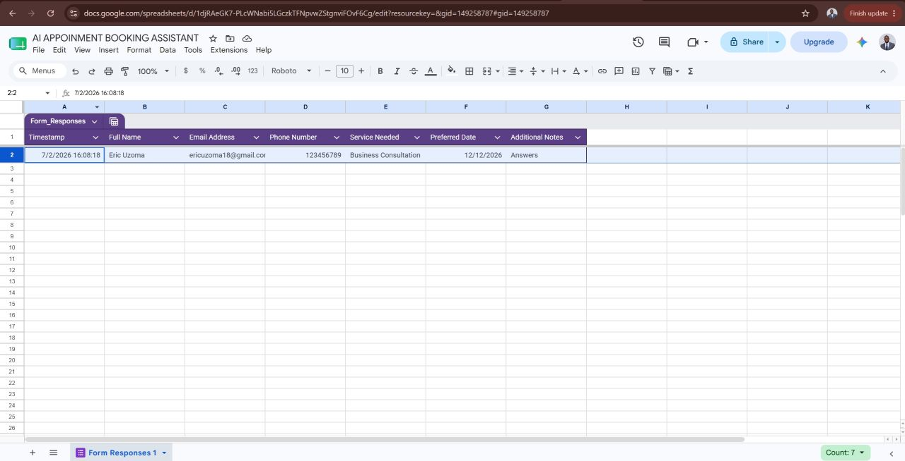
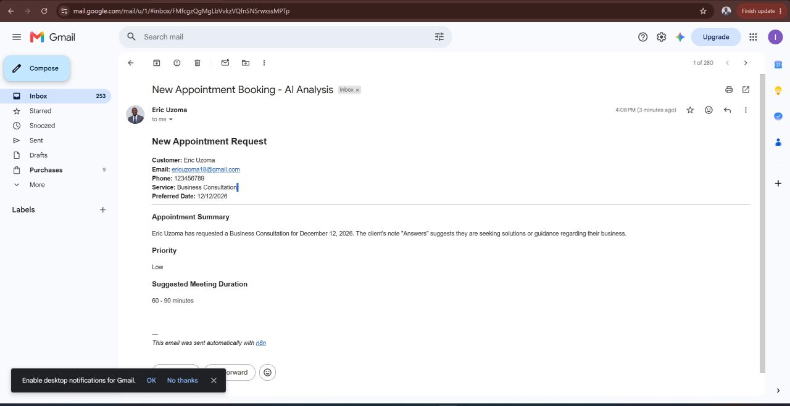
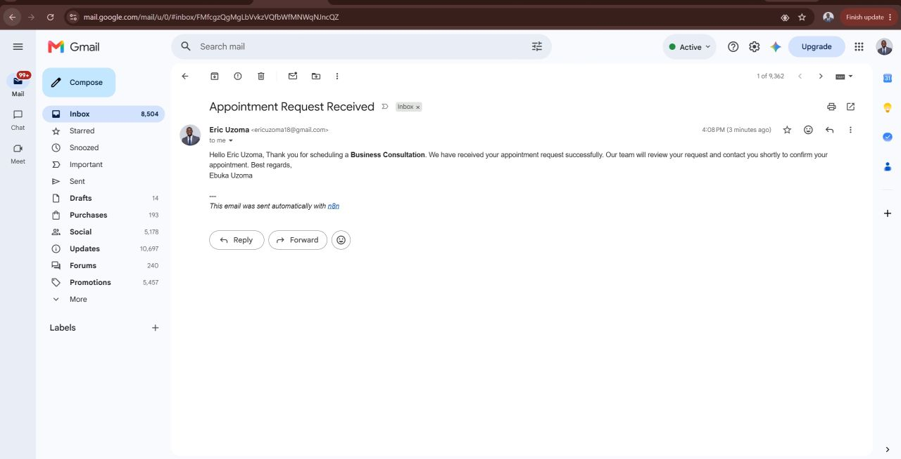

# AI Appointment Booking Assistant

An AI-powered appointment scheduling workflow that automates appointment request processing, customer email confirmations, and business summaries.

## Project Overview

Managing appointment requests manually can take time and lead to repetitive administrative work. This project uses AI and workflow automation to streamline the process from form submission to customer communication.

## How It Works

1. A customer submits an appointment request through Google Forms.
2. The form response is stored in Google Sheets.
3. n8n processes the appointment details and uses Google Gemini to analyze the information.
4. Gmail sends an automated confirmation email to the customer.
5. The workflow generates an AI-powered appointment summary for the business.

## Key Features

- Appointment request collection through Google Forms
- AI-powered analysis of booking details
- Automated customer confirmation emails
- AI-generated appointment summaries
- Workflow automation using n8n

## Technologies Used

- **n8n** — Workflow automation
- **Google Gemini** — AI-powered analysis and summaries
- **Google Forms** — Appointment request collection
- **Google Sheets** — Appointment data storage
- **Gmail** — Automated email communication

## Project Screenshots

Screenshots of the workflow and its results will be added here.

## Project Demo

Add a link to the project demonstration here.

## Business Value

This project demonstrates how AI and workflow automation can reduce repetitive administrative work, improve customer communication, and make appointment request processing more efficient.

## Disclaimer

This is a portfolio project demonstrating AI and workflow automation. Actual scheduling, calendar availability checks, and confirmed calendar bookings should only be claimed if implemented and tested.
## Project Demo

🎥 [Watch the AI Appointment Booking Assistant Demo](https://lnkd.in/p/e-m9rzJe)

## Project Screenshots

### Workflow Overview

### Appointment Request Form

### Appointment Responses

### AI-Generated Appointment Summary

### Customer Confirmation Email

